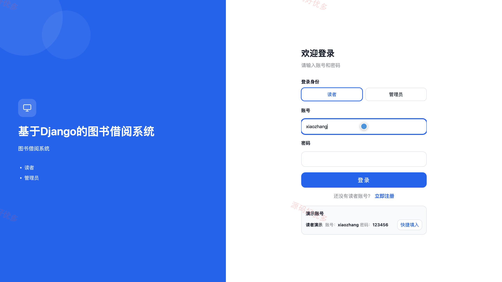
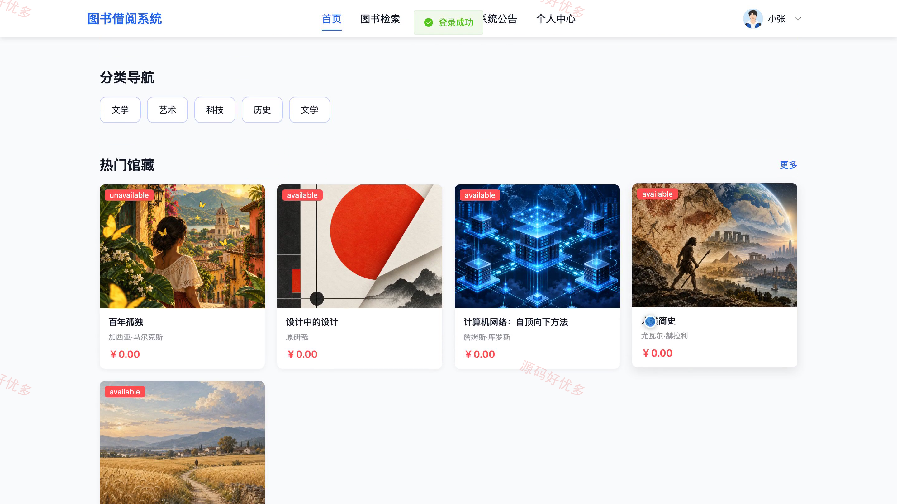
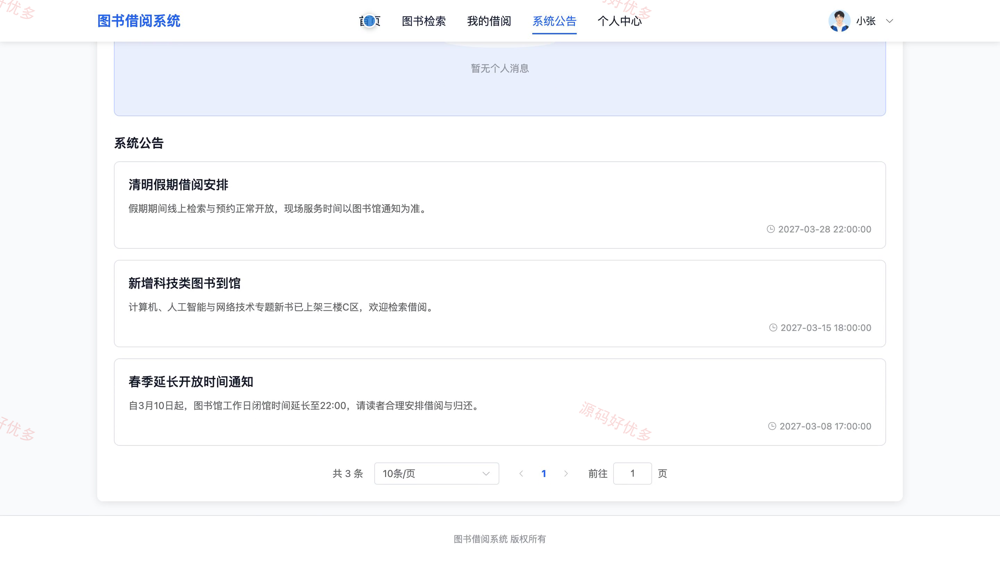
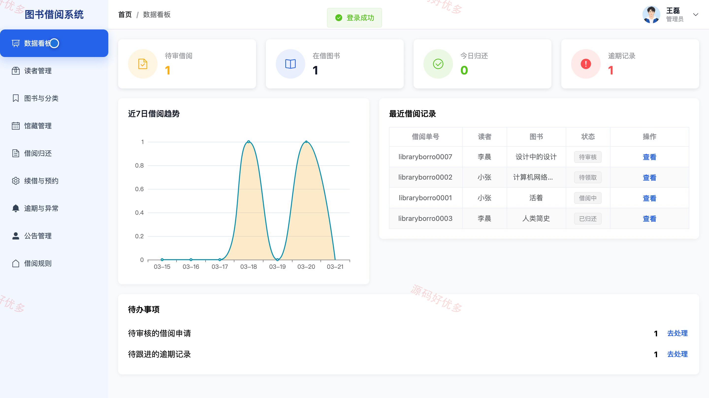
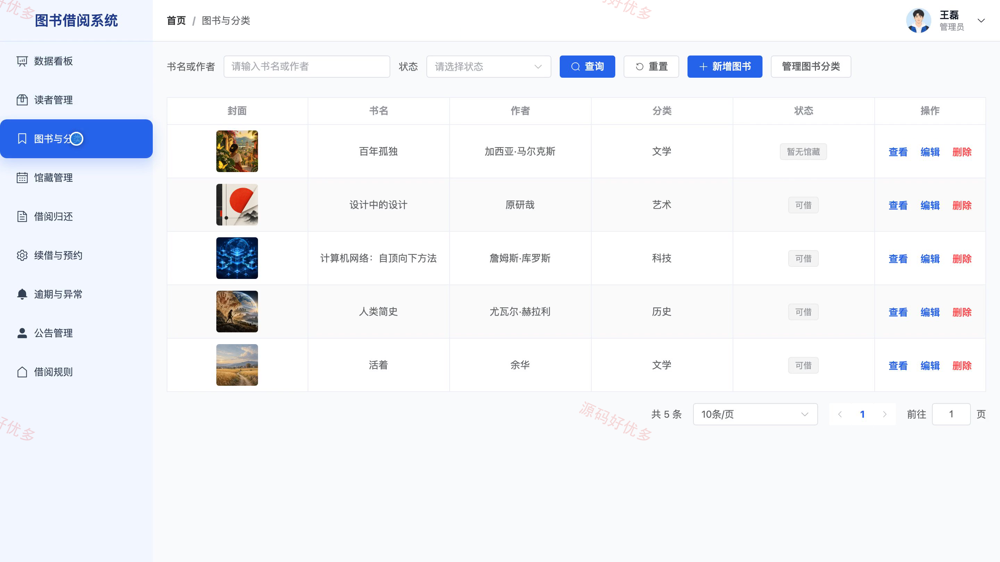
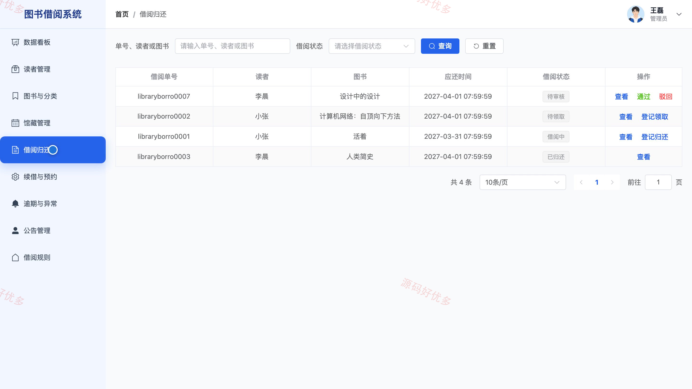
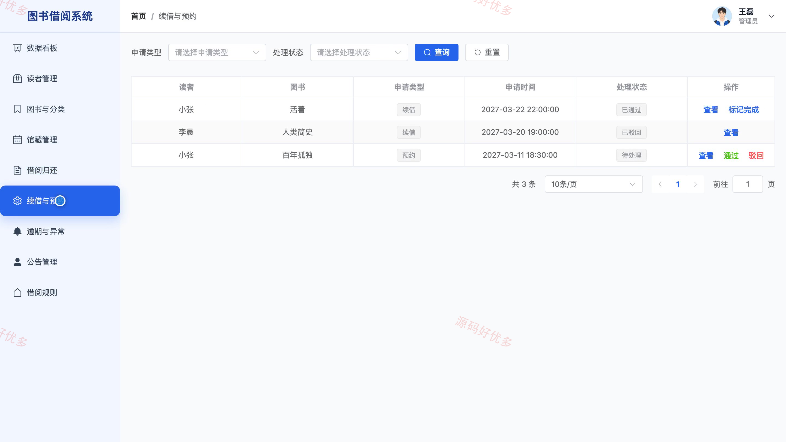

# bs122C
bs122C图书借阅系统
## 源码问题查看主页咨询

### 一、关键词
图书借阅、馆藏检索、借书还书、图书预约、读者服务

### 二、作品包含
源码+数据库+万字设计文档+PPT+全套环境和工具资源+本地部署教程

### 三、项目技术
前端技术： Html、Css、Js、Vue3.4、Element-Plus
后端技术：Python、Django

### 四、运行环境要求
开发工具：PyCharm + VSCODE

数据库：MySQL5.7+（共13张表）

数据库管理工具：Navicat10以上版本

环境配置软件： Python3+

前端Nodejs：16+

浏览器：谷歌浏览器

### 五、项目介绍
项目编号：bs122C

面向读者与馆员的图书借阅管理系统，提供馆藏检索、图书详情、预约与借阅记录查询，并支持图书、馆藏副本、借阅规则及归还异常的后台管理。

角色：读者、管理员

用户功能：馆藏检索、查看图书详情、预约图书、提交借阅申请、查看借阅记录与申请续借、收藏图书、维护个人资料。

管理员功能：图书与分类管理、馆藏副本管理、借阅审核与归还登记、预约及续借管理、归还异常处理、读者账号管理、公告与借阅规则管理。

### 六、运行截图

